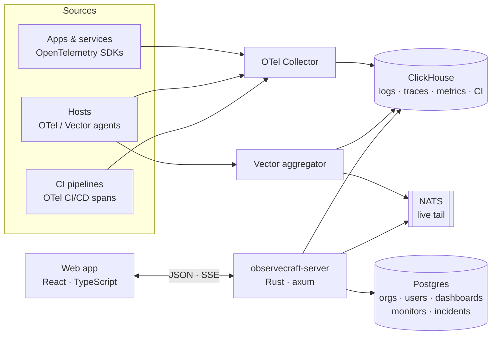

<div align="center">

<picture>
  <source media="(prefers-color-scheme: dark)" srcset="docs/assets/banner-dark.svg">
  
</picture>

**Open-source, self-hosted observability platform: logs, metrics, traces, dashboards, monitors, incidents and CI
visibility in one place, built on OpenTelemetry and ClickHouse.**

[](LICENSE)
[](https://www.rust-lang.org)
[](https://www.typescriptlang.org)
[](https://react.dev)
[](https://clickhouse.com)
[](https://opentelemetry.io)
<br>
[](CONTRIBUTING.md)
[](https://github.com/observecraft/observecraft/stargazers)
[](https://github.com/observecraft/observecraft/issues)
[](https://github.com/observecraft/observecraft/commits/main)

[Features](#features) · [Quickstart](#quickstart) · [Architecture](#architecture) · [Configuration](#configuration) ·
[Contributing](#contributing) · [License](#license)

</div>

<br>

<p align="center">
  
</p>

## Why ObserveCraft?

- **One place for your telemetry.** Search logs, explore traces, chart metrics, alert on all of them and run incidents
  without stitching five tools together.
- **Open standards in, your storage underneath.** Send data with OpenTelemetry or Vector; it lands in ClickHouse
  tables you own and can query directly.
- **Fast.** A Rust (axum) API over ClickHouse columnar storage. Search values are bound parameters, and live tail is
  pushed over NATS.
- **Enterprise-ready auth from day one.** Password + MFA, SAML 2.0, OpenID Connect, RBAC, application keys and an
  audit trail.
- **Self-hosted and MIT-licensed.** No per-host or per-GB pricing, and no data leaving your network.

## Features

| | Area | Highlights |
|---|---|---|
| 📜 | **Logs** | Query language with facets, histogram, live tail (SSE), saved views, anomaly insights, list/timeseries/top-list/table/tree-map/pie visualizations |
| 🧭 | **APM** | Service catalog, endpoints, recommendations (N+1 queries, error hot spots), deployments, service pages with latency/error breakdowns |
| 🔎 | **Trace explorer** | Span and trace search, facets, group-by analytics, flame graph, waterfall, span list, service map, span ↔ host metrics, logs and processes |
| 📈 | **Metrics** | Query engine (`avg:system.cpu.user{env:prod} by {host}`), metric catalog, tag values, span-derived `trace.*` metrics |
| 🧩 | **Dashboards** | Drag-and-drop dashboards, lists, starring, built-in host and APM dashboards |
| 🖥️ | **Infrastructure** | Host list and map, host details with metrics, processes, spans and logs |
| 🚨 | **Monitors** | Metric, APM, log and change monitors; warn/alert thresholds with recovery; backtesting; downtimes; templated notifications; quality checks |
| 🧯 | **Incidents** | Declare, triage, timeline, impacts, follow-ups and analytics |
| 🚀 | **Software Delivery** | CI pipeline explorer, flaky-test management, DORA metrics from OpenTelemetry CI/CD semantic conventions |
| 🔐 | **Identity** | Password + TOTP MFA, SAML 2.0, OIDC, sessions, roles, teams, SAML group mappings, application keys, audit trail |

<details>
<summary><b>📸 More screenshots</b></summary>
<br>

**APM: services and recommendations**


**Trace explorer**


**Monitors**


**Infrastructure**


**CI/CD pipelines**


</details>

## Quickstart

**Requirements:** Docker (Docker Desktop, OrbStack, Colima, …), Rust ≥ 1.89, Node.js ≥ 20, and `libxmlsec1` + `libxslt`
for SAML (`brew install libxmlsec1 libxslt` on macOS, `apt install libxmlsec1-dev libxml2-dev libxslt1-dev pkg-config`
on Debian/Ubuntu).

```bash
git clone https://github.com/observecraft/observecraft.git
cd observecraft
(cd web && npm install)

make up        # ClickHouse, Postgres, NATS, Vector aggregator, OTel Collector, synthetic logs
make server    # API on :8080 (applies migrations on startup)
make tracegen  # synthetic traces, host metrics and CI pipelines for the demo
make web       # UI → http://localhost:5173
```

On first start the server logs a one-time link to set the admin password:

```
No one can sign in yet. Set the admin password for … : http://localhost:5173/login/link/…
```

**Other ways to run:**

- **Everything in containers:** `docker compose -f deploy/docker-compose.yml --profile app up -d`.
- **UI only, no backend:** `make web-mock` runs the UI against in-browser mocks.
- **Try SSO locally:** `docker compose -f deploy/docker-compose.yml --profile sso up -d` starts a SAML IdP
  (SimpleSAMLphp on `:8081`, user `user1` / `user1pass`) and an OIDC provider (issuer `http://localhost:8082/default`).
  Configure them under *Organization Settings → Login Methods*.

### Send your own data

ObserveCraft ingests standard OTLP. Point any OpenTelemetry SDK or Collector at the bundled collector:

```bash
export OTEL_EXPORTER_OTLP_ENDPOINT=http://localhost:4318
export OTEL_SERVICE_NAME=my-service
export OTEL_RESOURCE_ATTRIBUTES=deployment.environment=dev,service.version=1.0.0
```

Logs can also be shipped with [Vector](https://vector.dev) to the aggregator configured in `deploy/vector/`.

## Architecture



| Path | What |
|---|---|
| `web/` | React + Vite + TypeScript UI. `src/api/*/client.ts` is the only data-access layer. |
| `server/` | Rust workspace: `oc-query` (search syntax → SQL / matcher), `oc-store` (ClickHouse + Postgres, migrations), `oc-api` (`observecraft-server`), `oc-tracegen` (synthetic data). |
| `server/migrations/` | ClickHouse (telemetry) and Postgres (metadata) schemas. |
| `deploy/` | Docker Compose stack, Vector aggregator + load generator, OTel Collector config. |

### API contract

The OpenAPI document is generated from the Rust handlers (utoipa), and the web's TypeScript types are generated from
it: run **`make openapi`** after changing an endpoint. `web/src/api/http.ts` checks paths, bodies and responses against
`web/src/api/generated/schema.d.ts` at compile time. The live spec is served at `GET /api/openapi.json`.

## Configuration

The server reads its settings from environment variables; see [`.env.example`](.env.example) for the full list. The
most important ones:

| Variable | Default | Description |
|---|---|---|
| `OC_HTTP_ADDR` | `0.0.0.0:8080` | API listen address |
| `OC_CLICKHOUSE_URL` | `http://localhost:8123` | ClickHouse HTTP endpoint (`OC_CLICKHOUSE_USER` / `_PASSWORD`) |
| `OC_POSTGRES_URL` | `postgres://observecraft:…@localhost:5432/observecraft` | Postgres connection string |
| `OC_NATS_URL` | `nats://localhost:4222` | NATS for live tail |
| `OC_PUBLIC_URL` | `http://localhost:5173` | Origin users open the app on (SSO redirects and login links) |
| `OC_SECRET_KEY` | — | **Required in production.** Encrypts MFA seeds and OIDC secrets (`openssl rand -base64 48`) |
| `OC_COOKIE_SECURE` | `false` | Set `true` when served over HTTPS |
| `OC_SESSION_HOURS` | `12` | Idle session lifetime (sessions also end 7 days after sign-in) |
| `OC_WEB_DIST` | — | Serve the built web app from the API (production-style) |
| `OC_SEED_DEMO` | `true` | Fictional demo users, teams, monitors and incidents for an empty org. **Set `false` in production.** |

## Security

- **Tenancy:** every table carries `org_id`; a request's org and user come only from its session or application key,
  never from client input.
- **Queries:** all search values *and* tag keys are bound parameters (`oc-query::build_where`), never interpolated into
  SQL.
- **Authentication:** Argon2id passwords, TOTP MFA, account lockout, signed SAML responses (SHA-256+, replay
  protection), OIDC with PKCE and nonce, HttpOnly SameSite cookies with origin checks on writes.
- **Roles:** Admin, Standard and Read Only, enforced by the API.

Found a vulnerability? Please report it privately; see [CONTRIBUTING.md](CONTRIBUTING.md#reporting-security-issues).

## Project status

ObserveCraft is under active development and **not yet production-ready**: APIs and schemas may still change between
releases.

| Area | Status |
|---|---|
| Logs, live tail, APM, trace explorer, metrics, dashboards, infrastructure | ✅ Live (ClickHouse) |
| Monitors, downtimes, incidents, identity & SSO, audit trail | ✅ Live (Postgres) |
| CI visibility, flaky tests, DORA metrics | ✅ Live (ClickHouse) |
| Error tracking, integrations catalog | 🧪 UI with in-browser mocks |
| Notification delivery (email, chat, on-call) | 🗺️ Planned |
| Continuous profiling, live debugger, RUM | 🗺️ Planned |
| Log archives (S3 / Parquet + DuckDB search) | 🗺️ Planned |
| Trace ↔ log correlation by `trace_id` | 🗺️ Planned |
| Kubernetes / container inventory | 🗺️ Planned |

**Retention:** `oc.logs` keeps 15 days, OTel trace/metric tables 72 hours, and CI traces 30 days (ClickHouse TTLs).

## Contributing

Contributions are very welcome! Read [CONTRIBUTING.md](CONTRIBUTING.md) for the development setup, coding guidelines
and pull-request process. A quick check before you push:

```bash
make test       # Rust tests + web typecheck
make openapi    # if you changed an API endpoint
```

## License

ObserveCraft is released under the [MIT License](LICENSE).

<div align="center">
<sub>Built with Rust, React, ClickHouse and OpenTelemetry.</sub>
</div>
